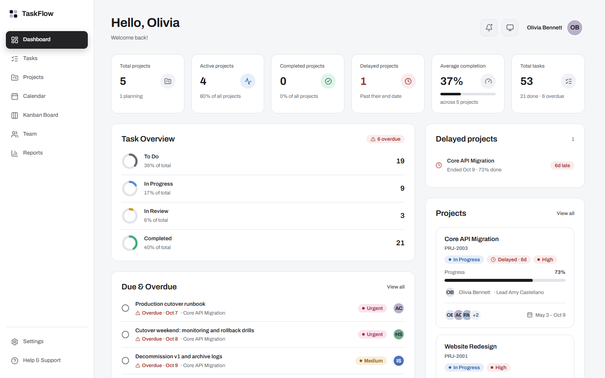
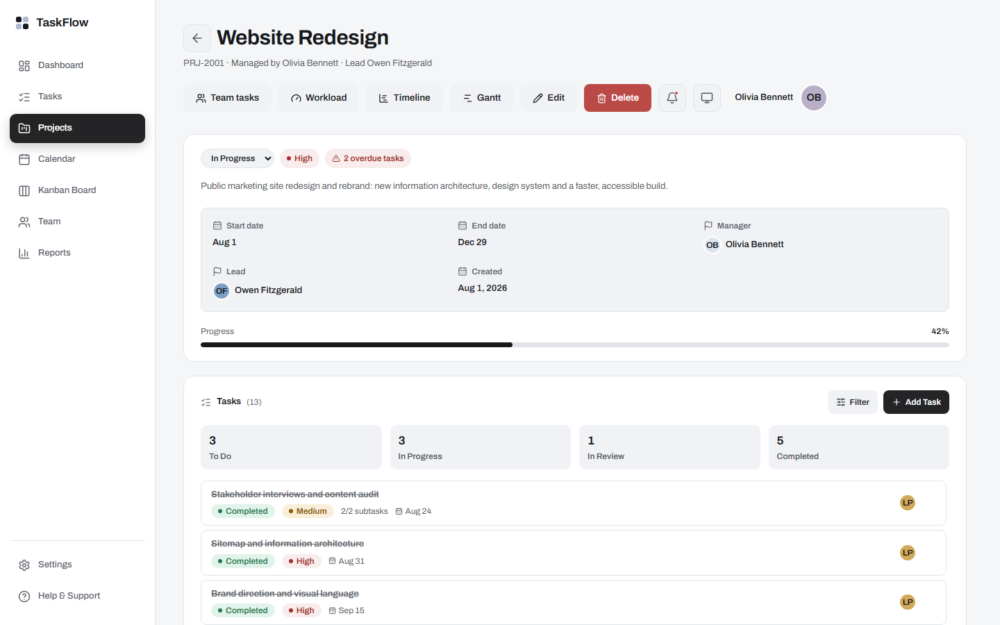
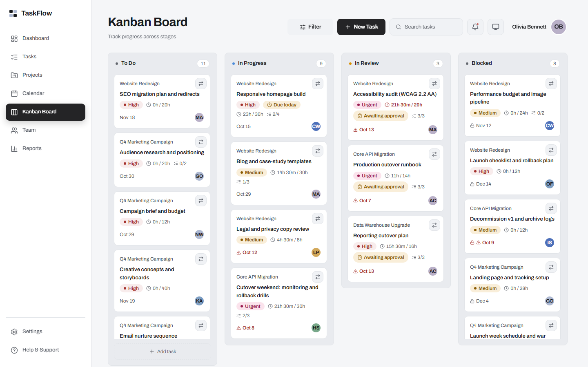
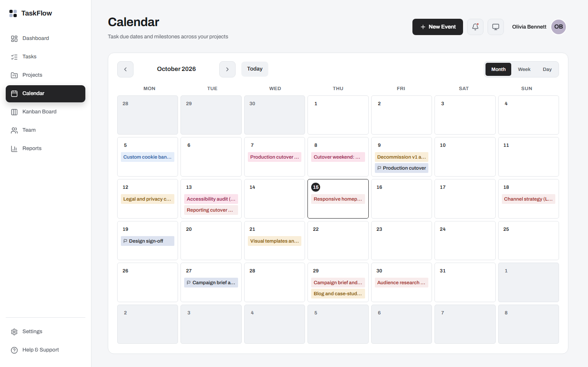

# Task & Project Management System

A full-stack task and project management app — React (Vite) frontend, Spring Boot REST API backend, PostgreSQL database, containerized with Docker and built via GitHub Actions.

## Documentation

All project documentation lives in [docs/](docs/README.md); this README is the quick start and overview.

| Looking for | Read |
|---|---|
| Everything, with the reading order | [docs/README.md](docs/README.md) |
| Install, configure and run it | [docs/setup.md](docs/setup.md) |
| What each screen does and how it works (one short page per screen) | [docs/pages_docs/](docs/pages_docs/README.md) |
| How it is built | [docs/architecture.md](docs/architecture.md), [backend](docs/backend.md), [frontend](docs/frontend.md), [decision records](docs/adr/README.md) |
| The API | [docs/api-reference.md](docs/api-reference.md) |
| Data and rules in the database | [docs/database.md](docs/database.md) |
| Roles, permissions and sign-in | [docs/authentication-authorization.md](docs/authentication-authorization.md), [security](docs/security.md) |
| How it is tested | [docs/testing.md](docs/testing.md), [test cases](docs/test-cases.md) |
| What is done, known issues, what changed | [docs/roadmap.md](docs/roadmap.md), [docs/issues.md](docs/issues.md), [docs/changelog.md](docs/changelog.md) |
| The requirements it is built against | [assignment-brief.md](assignment-brief.md), [project-workflow.md](project-workflow.md) |
| Hosting it (Vercel, Render, Neon), the Gmail mail route and the administrator sign-in code | [host/README.md](host/README.md) |
| The Google OAuth consent screen: the public home, privacy and terms pages and the manual steps | [docs/google-oauth-verification.md](docs/google-oauth-verification.md) |
| Branching and pull requests | [Contributing.md](Contributing.md) |

## Screenshots

Seeded demo data, light theme (the app also has a dark theme).

| | |
|---|---|
| **Dashboard**: figures, due and overdue work, delayed projects, workload<br> | **Project page**: overview, tasks, members, milestones, files, activity<br> |
| **Kanban board**: five columns, drag a card to move it<br> | **Calendar**: month, week and day views of due dates and milestones<br> |

## Features

- **JWT Authentication + self-registration**: login with a username **or e-mail address** and a password, issuing a 15-minute signed JWT (HS512) that the browser keeps in memory only and renews from an httpOnly refresh cookie (deleted on sign-out and on a password change); passwords hashed with BCrypt, never stored or returned in plaintext. New accounts can also self-register and must verify a one-time email code (sent via Mailpit locally) before they can log in
- **Project-scoped authorization**: three system roles (`USER` — the default, no special access; `PROJECT_MANAGER` — may create projects; `ADMINISTRATOR` — a global bypass for user/role management and every project) and four per-project roles (`OWNER` = the project's Project Manager, `ADMIN` = Team Leader, `MEMBER` = Team Member, `VIEWER` in `project_members`). Every check asks a data-driven resource × action matrix (`permissions` / `role_permissions`, editable by an administrator) through `ProjectAccessGuard` — an `OWNER` can do everything on the project except what the matrix withholds, an `ADMIN` manages content and approves work, a `MEMBER` works on tasks assigned to them, a `VIEWER` is read-only, and a project always has exactly one active `OWNER` (see [ADR-0015](docs/adr/0015-two-level-roles-system-and-project.md))
- **Project & Task Management API**: full CRUD for projects, tasks, milestones, project members, task assignees, task dependencies, subtasks, checklist items, comments (with replies and @mentions), file attachments and time logs, plus the task approval workflow, the manager views (team tasks, workload, dashboard statistics) and server-side KPIs and reports — all 136 endpoints are in [docs/api-reference.md](docs/api-reference.md)
- **Task Dependencies**: model "task X can't start until task Y is done," with database-level cycle prevention; blocked tasks are surfaced to API/UI consumers by name, not just silently rejected
- **Subtask/task status rules**: a task can't be marked `COMPLETED` while it has an incomplete subtask; touching a subtask on a still-To-Do task auto-promotes it to In Progress (skipped if the task is itself blocked by an incomplete dependency) — see [Task & Subtask Rules](docs/backend.md#task--subtask-rules)
- **Completed means closed**: a `COMPLETED` project takes no new task, milestone, subtask, checklist item, comment, time entry, file or dependency, and a `COMPLETED` task takes no new subtask, checklist item, comment, time entry, file or dependency. The server answers `409` and the screens hide the controls; changing the status back reopens it (decision D-27).
- **Database-enforced business rules**: auto-managed timestamps, date-range validation (task/milestone due dates constrained to their project's dates), case-insensitive username/email uniqueness, task-dependency ordering (a task can't go active while a dependency is incomplete, checked from both directions), assignment integrity (assignee must be an active project member), task/milestone/project consistency, and project/milestone/task progress auto-derived from completion (writable but not authoritative — recomputed on every relevant change)
- **Role-level permissions**: the `permissions` / `role_permissions` matrix (seven actions — View, Create, Edit, Delete, Assign, Approve, Generate Reports — over each resource, for both the system and the project roles) is what the backend enforces, cached and re-read when an administrator saves the grid in *Administration → Roles & Permissions* (see [docs/database.md](docs/database.md#13-authorization-and-permissions) and [ADR-0014](docs/adr/0014-requirement-roles-and-permission-matrix.md))
- **Overdue detection**: a `v_overdue_tasks` view plus a `fn_generate_overdue_notifications()` DB function feed the overdue state, and a daily scheduled job (`DeadlineScheduler`, 08:00 and at startup) sends the **deadline reminders** (3 and 1 days before) and **overdue notices** to the assignees and the project Owner, at most once each — see [docs/notifications.md](docs/notifications.md#8-deadline-reminders-and-overdue-notices-since-2026-10-10); overdue/blocked state is also surfaced directly on tasks in the UI (an "N overdue tasks" badge on the project detail page, a lock icon + tooltip naming the blocking task), and an open task due today or within 3 days carries a "Due today / tomorrow / in N days" flag (`dueSoon`, calculated on the server)
- **Frontend UI** (React, wired to the live backend API): login, self-registration + OTP verification, dashboard (project and task statistics, Delayed projects, recent activity, manager workload), Kanban board, calendar (task due dates and milestones; month, week and day), project list with search, filters and sort, a full project detail page (status/priority/dates/manager/progress/completion date, a filterable task list with an Add Task action, members with a role picker, milestones you can add, edit and delete, attachments, activity, plus team-tasks, workload, timeline and Gantt views), task list (with Today / Upcoming / In Progress / Completed / Overdue quick views), team view, Reports (overview charts, the five KPIs and the seven named reports, each saved as an Excel or PDF file), administration (users, roles and permissions), profile, and settings (including a light/dark theme switcher) — all fetching real data, with working sort/search/filter and create/edit/delete flows (not just reads)
- **Task workflow**: a task's status advances one stage per click (To Do → In Progress → In Review → Completed) and never silently reopens a finished task. Entering review opens an **approval request**: a Team Leader or the Owner (or a designated approver) approves it, requests changes or rejects it with a comment, and nobody approves their own work except the Owner — see [docs/tasks.md](docs/tasks.md)
- **Notifications**: real per-user notifications (not mocked) — created automatically on task assignment (naming the assigner, project and due date), task status change, approval requests and decisions, deadline reminders, overdue notices and project invitations/responses, with a read/unread bell dropdown in the UI — see [Notifications](docs/notifications.md). Comments and replies, project edits and milestone edits notify the people with work in them (assignees plus the project's Owner and Team Leaders, never the person who acted)
- **Activity log**: a history feed (who did what, when) per task, per project and a recent-activity list for the dashboard — project, task, subtask, milestone, comment, file and approval events are written internally by the services, not directly postable
- **Self-service account settings**: any authenticated user can update their own profile, password, and photo (`PUT /api/users/me`, `/me/password`, `/me/photo`) without needing an Administrator
- **List search, filter, sort and paging**: `GET /api/projects` and `GET /api/tasks` take the search, filter and sort fields of the specification as optional parameters, and those two lists and `GET /api/notifications` can be read a page at a time (`?page` / `?size`); the notification bell loads 20 at a time. Every parameter is optional and only narrows what the caller may already see.
- **Optional second sign-in step for administrators**: with `ADMIN_2FA_ENABLED=true` (default `false`) a correct password for an `ADMINISTRATOR` only starts a 6-digit e-mailed code (`POST /api/auth/login/verify` then issues the session); every other role signs in as before ([ADR-0016](docs/adr/0016-admin-two-factor-and-https-mail.md))
- **E-mail over SMTP or the Gmail API**: one-time codes go over SMTP (Mailpit locally) or, when the three `GMAIL_*` values are set, through the Gmail API over HTTPS, which hosts that block SMTP (Render's free tier) allow
- **Optional "Sign in with Google", also for new accounts**: with `GOOGLE_CLIENT_ID` set, the sign-in and Create Account pages show Google's button. A Google account that is connected to a TaskFlow account (done from **Profile** with the current password) signs in to it; one that is connected to nobody and whose e-mail Google verified and no account uses creates a new account, with a username the person chooses (never a duplicate) and no password until they set one on Profile, confirmed with Google. Nothing is ever matched by e-mail address (the key is Google's `sub`), the password keeps working, and an administrator still gets the e-mailed code ([docs/google-sign-in.md](docs/google-sign-in.md), [ADR-0017](docs/adr/0017-link-only-google-sign-in.md), [ADR-0018](docs/adr/0018-google-sign-up-and-first-password.md))
- **Public home, privacy policy and terms pages**: `/`, `/privacy-policy` and `/terms-of-service` open without signing in (a signed-in person still gets the dashboard at `/`), for the Google OAuth consent screen ([docs/google-oauth-verification.md](docs/google-oauth-verification.md))
- **Backend file logging**: errors and security/business events (validation failures, access-denied, failed logins, unhandled exceptions) are written to a rotating log file (`backend/logs/log.txt`); the console stays quiet (`logback-spring.xml` logs to the file only) — see [Logging](docs/backend.md#logging)

## Table of Contents

1. [Documentation](#documentation)
2. [Screenshots](#screenshots)
3. [Features](#features)
4. [Tech Stack](#tech-stack)
5. [Architecture Overview](#architecture-overview)
6. [Prerequisites](#prerequisites)
7. [Setup Instructions](#setup-instructions)
8. [Environment Variables](#environment-variables)
9. [Database Migrations](#database-migrations)
10. [Running the Application](#running-the-application)
11. [Deployment](#deployment)
12. [API Documentation](#api-documentation)
13. [Project Structure](#project-structure)
14. [Security Features](#security-features)
15. [Testing the API](#testing-the-api)
16. [Troubleshooting](#troubleshooting)
17. [License](#license)
18. [Contributors](#contributors)
19. [Future Enhancements](#future-enhancements)

## Tech Stack

### Backend

- Java 25 (LTS)
- Spring Boot 4.0.8 — REST API framework (Web MVC, Data JPA, Security, Validation, OAuth2 Resource Server starters)
- Spring Data JPA / Hibernate 7.2.24 — ORM/data layer
- Spring Security + JWT (`jjwt` 0.12.6, HS512) — stateless authentication; most authorization is project-scoped checks in service code (`ProjectAccessGuard`) rather than `@PreAuthorize`, which is now reserved for the handful of genuinely system-wide actions
- Jakarta Bean Validation — request validation
- Spring Mail (`spring-boot-starter-mail`) — sends the one-time codes (the self-registration code and the administrator's sign-in code): SMTP via the docker-compose `mailpit` service locally, or the Gmail API over HTTPS through Spring's `RestClient` when the `GMAIL_*` values are set (hosts that block SMTP)
- PostgreSQL JDBC driver — database connectivity (`ddl-auto=validate`; schema owned by SQL files, not Hibernate)
- Maven (bundled `./mvnw` wrapper) — build tool

### Database

- PostgreSQL 18 (`postgres:18-alpine` in Docker; CI uses `postgres:18` as a throwaway test instance)
- Plain SQL schema ([database/init/01-init.sql](database/init/01-init.sql)), no ORM-driven schema generation
- Flyway (via Redgate Flyway Desktop) — versioned migration history ([database/taskmanager/](database/taskmanager/)), applied to an existing database by the one-shot `migrate` service in `docker-compose.yml`; the Spring app itself does not run Flyway

### Frontend

- React 19.2 — UI library
- Vite 8.2 — build tool / dev server
- React Router DOM 7.18 — routing
- Recharts 3.10 — charts (Reports/Dashboard)
- write-excel-file 4.1, jsPDF 4.2 and jspdf-autotable 5 — the Excel and PDF files of the reports, made in the browser and loaded the first time one is asked for
- Tailwind CSS 4.3 (`@tailwindcss/vite`) — styling, including a light/dark theme CSS-variable system
- lucide-react — icon set
- Playwright (`@playwright/test`) — end-to-end tests (`frontend/e2e/`) that drive the real app against the real backend, no mocking — see [docs/frontend.md](docs/frontend.md#testing)
- React Context — `layout/LayoutContext.jsx` (local UI state: sidebar/layout), `auth/AuthContext.jsx` (JWT + logged-in user), `theme/ThemeContext.jsx` (light/dark/system theme preference), `data/UsersContext.jsx` (fetched user directory, for avatar/assignee lookups), `data/NotificationsContext.jsx` (unread count + list, backing the top-bar bell). No react-query/SWR/Redux — a small custom `useApi` hook (`api/useApi.js`) covers fetch-on-mount/refetch for a project this size
- Small reusable UI primitives (`components/ui/`) — `Modal`, `Dropdown` (generic popover, used for filter/sort menus, the notifications bell, and per-row action menus), `ConfirmDialog`, `Toast`, `Skeleton`, `EmptyState`, `LookupSelect` (position/department pickers), `ThemeToggle` (the one-click Light / Dark / System button, used by the top bar and the public pages) — built once and reused rather than one-off per page

## Architecture Overview

### Backend Architecture

```
backend/src/main/java/backend/
├── BackendApplication.java   # Entry point
├── controller/                # REST controllers — bind/validate requests, delegate to services (27 controllers)
├── service/                   # Business logic, transaction boundaries, DTO <-> entity mapping
│                               # (includes ProjectAccessGuard — the shared project-scoped authorization check)
├── entity/                    # JPA entities (25 of the schema's 27 tables mapped; `report_exports` and `kpi_snapshots` are not)
├── repository/                # Spring Data JPA repositories
├── dto/                       # Request/response DTOs — no controller binds/returns raw entities
├── security/                  # Resource and Action enums, PermissionChecker (the @permissions bean used in @PreAuthorize)
├── exception/                 # NotFoundException, ConflictException, TooManyRequestsException, SessionExpiredException, MailDeliveryException + GlobalExceptionHandler (@RestControllerAdvice)
├── util/                      # TextFormat, Derived (delayed/overdue), WorkloadClassifier, FileTypeGuard (attachment types), Mentions (@username in comments), ProjectListQuery / TaskListQuery (list search, filter, sort), PageParams (optional paging)
└── config/                    # SecurityConfig (JWT, CORS, method security), JwtSecretGuard, ActiveAccountJwtValidator, DeadlineScheduler
```

### Frontend Architecture

```
frontend/src/
├── main.jsx            # Entry point — wraps App in AuthProvider + ThemeProvider + UsersProvider + NotificationsProvider + ToastProvider
├── App.jsx             # Route definitions (/login, /register, /verify-otp, /privacy-policy, /terms-of-service public; / is the public home for a signed-out visitor; everything else behind ProtectedRoute)
├── pages/               # One file per route — Landing (the public home), PrivacyPolicy, TermsOfService, Login, Register, VerifyOtp, Dashboard, Projects, ProjectDetail,
│                        # ProjectViews (team tasks / workload / timeline / Gantt), Tasks, Kanban, Team, Calendar, Reports,
│                        # Profile, Settings, Help (Help & Support), ErrorPage (404, 403, 500 … for every error status),
│                        # admin/UsersAdmin, admin/RolesPermissions, admin/AuditLog
├── components/          # Shared components (ProjectCard, StatCard, TaskDetailPanel, TaskFormModal, NewProjectModal,
│                        # AddMemberModal, EditUserModal, RoleFormPanel, KanbanMoveMenu, AddProjectMemberModal, AddLookupModal, TimeTracking, ChecklistSection,
│                        # MentionInput, CommentText, AttachmentsSection, ApprovalChip, DelayedBadge, ProjectActivity, TeamTasksView, WorkloadTable,
│                        # TimelineView, GanttChart, MilestoneFormModal, DueSoonBadge, GoogleButton, GoogleSignInSection, GoogleSignupForm, GoogleSetPasswordSection) and components/reports/ (the Reports tabs)
├── components/ui/       # Presentational primitives (Avatar, Badge, ProgressBar, ProgressRing, LookupSelect, Combobox, Modal,
│                        # SidePanel, Checkbox, Dropdown, ConfirmDialog, Toast, Skeleton, EmptyState, Logo, PasswordChecklist, TimeChip,
│                        # useDirtyForm, ThemeToggle)
├── components/public/   # PublicLayout (skip link, header, theme button, footer) and LegalDocument, shared by the public pages
├── config/site.js       # Operator name, contact e-mail and dates printed on the public pages
├── layout/              # App shell — Sidebar, TopBar (the sticky page header: search/filter/notifications bell), layout state (React Context)
├── auth/                # AuthContext (JWT/login/logout/refreshProfile/permissions), ProtectedRoute, RequirePermission, IdleLogout (inactivity warning and sign-out), useGoogleSignIn (the Google sign-in and sign-up steps)
├── theme/               # ThemeContext (light/dark/system preference, persisted per-user)
├── api/                 # Fetch client + one file per backend resource (projects, tasks, subtasks, comments, milestones,
│                        # taskAssignees, taskDependencies, projectMembers, users, roles, positions, departments,
│                        # notifications, activityLog, auth, ...) + stats/format/relations/permissions/validation helpers
├── data/                # UsersContext.jsx (getMember(id) for avatar/assignee lookups), NotificationsContext.jsx (unread count + list)
└── styles/global.css    # Tailwind entry point + light/dark theme CSS variables

frontend/e2e/            # Playwright end-to-end specs — see docs/frontend.md#testing
```

### Key Design Decisions

1. **Stateless JWT auth over server sessions** — a short-lived access token plus a revocable refresh token (an httpOnly cookie, its hash in `refresh_tokens`); the JWT carries the user's role as a custom claim; a custom `JwtAuthenticationConverter` maps it into a Spring Security authority, since the default converter only reads OAuth2 `scope` claims.
2. **Project-scoped, row-level authorization, not global role gates** — `@PreAuthorize` is now reserved for the few genuinely system-wide actions (user/role management, creating org-wide Positions/Departments); almost everything else is checked in service code (`ProjectAccessGuard`) against the caller's own `project_members.project_role` for that *specific* project (`OWNER`/`ADMIN`/`MEMBER`/`VIEWER`), not a global role. Task updates layer one more row-level check on top: anyone who isn't a project `OWNER`/`ADMIN` may only update a task they're personally assigned to, and only its status/progress.
3. **DTOs on every endpoint, not raw entities** — prevents leaking fields like `passwordHash` through nested associations (e.g. a project's `manager`), and decouples the API shape from the JPA entity graph.
4. **Schema owned by hand-written SQL, not Hibernate** — `ddl-auto=validate`, so the app fails fast if entities drift from the real schema instead of silently auto-migrating.
5. **Business rules pushed into the database via triggers** where they're cross-row (cycle prevention and ordering on task dependencies, date-range checks, assignee/project-membership integrity, task/milestone/project consistency, project/milestone progress kept in sync with task completion) — Java-level validation only covers what's expressible per-request (Bean Validation). Each `RAISE EXCEPTION` explicitly sets `ERRCODE = '23514'` (check_violation) — without it, Postgres's default error code isn't in the SQLSTATE class Hibernate treats as a constraint violation, so the error would fall through to a generic unhandled 500 instead of a clean 400 with the actual reason. Full list: [docs/database.md](docs/database.md#5-triggers-and-functions).
6. **Notifications are created by application code, not database triggers** (`NotificationService`, called from `TaskAssigneeService`, `TaskService`, `TaskApprovalService` and `ProjectMemberService`; `UpdateNotificationService`, called from `CommentService`, `ProjectService` and `MilestoneService`; `DeadlineNotificationService`, run by a daily job) — unlike the cross-row rules above, "who should be notified" already requires looking up related rows (assignees) that the service layer has on hand anyway, and keeping it in Java keeps the notification text/type logic in one reusable place instead of duplicated PL/pgSQL.
7. **First use of `Authentication` as a controller parameter** (`UserController.updateOwnProfile`, `NotificationController`) — every other endpoint operates on an explicit `{id}` path variable; self-service endpoints instead resolve "who is this?" from `authentication.getName()` (the JWT's `sub` claim), so a user can only ever act on their own row.
8. **Frontend calls the backend via relative `/api/...` paths, not an absolute URL** — nginx already reverse-proxies `/api/` to the backend container in the Docker build ([frontend/nginx.conf](frontend/nginx.conf)), and a matching Vite dev-server proxy (`frontend/vite.config.js`) makes the same code work under `npm run dev`. No frontend env var for the API base URL is needed. On Vercel the same relative paths work because [frontend/vercel.json](frontend/vercel.json) rewrites `/api/*` to the Render backend (and every other path to `index.html`).
9. **A subtask touch can promote its parent task, but never demote or complete it** — checking a box on a still-To-Do task's subtask auto-promotes the task to In Progress (a clear "work has started" signal), but nothing ever auto-completes a task just because every subtask is done, and unchecking a subtask never reverts the parent — task status stays otherwise entirely manual, so a user's own explicit status change is never second-guessed. See [Task & Subtask Rules](docs/backend.md#task--subtask-rules).

## Prerequisites

- Java 25 (backend)
- Node.js 20 (pinned in CI) and npm (frontend)
- PostgreSQL 18, or Docker + Docker Compose to run it in a container
- Maven (or the bundled `./mvnw` wrapper)
- Git

## Setup Instructions

1. Clone the repo.
2. Copy the root env file: `cp .env.example .env` (used by Docker Compose for Postgres/backend/frontend ports and credentials).
3. Backend: `cd backend && ./mvnw spring-boot:run` — reads DB connection from `SPRING_DATASOURCE_*` env vars (defaults match `.env.example`) and the JWT secret from `JWT_SECRET`. Self-registration needs somewhere to send the OTP email — either point `MAIL_*` at a real SMTP server, or just run the docker-compose stack (below), which starts a local Mailpit catcher automatically.
4. Frontend: `cd frontend && npm install && npm run dev`.

Running the full stack via Docker Compose (`docker compose up -d --build`, see [Running the Application](#running-the-application)) covers steps 3–4 for you, plus Postgres and Mailpit — the fastest way to get everything running together.

## Environment Variables

### Root `.env` (Docker Compose)

| Variable | Description | Example |
|---|---|---|
| POSTGRES_USER | Postgres superuser (init/migrations only — the backend doesn't connect as this) | postgres |
| POSTGRES_PASSWORD | Postgres superuser password | postgres |
| POSTGRES_DB | Database name | taskmanager |
| POSTGRES_PORT | Host port for Postgres | 5432 |
| TASKMANAGER_APP_PASSWORD | Password for `taskmanager_app`, the least-privileged role the backend actually connects as (see [docs/database.md](docs/database.md#7-least-privilege-application-role)) | (long random string — change in every real deployment) |
| JWT_SECRET | HMAC signing key for JWTs, passed to the backend container (also in the backend table below) | (long random string — change in every real deployment) |
| CORS_ALLOWED_ORIGINS | Allowed browser origins, passed to the backend container | http://localhost:5173,http://localhost:80 |
| BACKEND_PORT | Host port for the backend container | 8080 |
| FRONTEND_PORT | Host port for the frontend container | 5173 |
| MAIL_HOST / MAIL_PORT | SMTP server for the registration OTP email | mailpit / 1025 (docker-compose default) |
| MAIL_USERNAME / MAIL_PASSWORD | SMTP auth, if the server needs it | (blank for Mailpit) |
| MAIL_SMTP_AUTH / MAIL_SMTP_STARTTLS | SMTP auth/STARTTLS toggles | false / false (Mailpit needs neither) |
| MAIL_FROM / MAIL_FROM_NAME | "From" address and display name on the OTP email (with the Gmail API, the Gmail address that granted the token) | no-reply@taskflow.dev / TaskFlow |
| GMAIL_CLIENT_ID / GMAIL_CLIENT_SECRET / GMAIL_REFRESH_TOKEN | When all three are set, codes are sent through the Gmail API over HTTPS instead of SMTP (hosts that block SMTP ports, e.g. Render's free tier); see [host/README.md](host/README.md) section 5 | (blank: SMTP) |
| ADMIN_2FA_ENABLED | `true` = an ADMINISTRATOR must enter a 6-digit code e-mailed to them after the password (see [ADR-0016](docs/adr/0016-admin-two-factor-and-https-mail.md)); keep `false` until the administrator's e-mail is a real mailbox | false |
| GOOGLE_CLIENT_ID | OAuth client ID (type Web application) for "Sign in with Google"; public, there is no client secret. Blank switches the feature off: no button, every Google endpoint refuses (see [docs/google-sign-in.md](docs/google-sign-in.md)) | (blank: off) |
| MAILPIT_SMTP_PORT / MAILPIT_UI_PORT | Host ports for Mailpit's SMTP listener and its web UI (`http://localhost:8025`) | 1025 / 8025 |

### Backend (`application.properties`, overridable via env)

| Variable | Description | Example |
|---|---|---|
| SPRING_DATASOURCE_URL | JDBC connection string | jdbc:postgresql://localhost:5432/taskmanager |
| SPRING_DATASOURCE_USERNAME | DB username | taskmanager_app |
| SPRING_DATASOURCE_PASSWORD | DB password | taskmanager_app_password |
| JWT_SECRET | HMAC signing key for JWTs | (long random string — change in every real deployment; a startup `WARN` fires if this is left at the built-in default) |
| JWT_EXPIRATION_MS | Access-token lifetime in ms | 900000 (15 minutes) |
| REFRESH_EXPIRATION_MS | Refresh-cookie lifetime in ms | 604800000 (7 days) |
| REFRESH_COOKIE_SECURE | `true` when the site is served over HTTPS | false |
| CORS_ALLOWED_ORIGINS | Comma-separated allowed origins | http://localhost:5173,http://localhost:80 |
| SECURITY_LOG_LEVEL | Log level for Spring Security's own logger | INFO (default); DEBUG for local JWT/role troubleshooting |
| ATTACHMENT_MAX_BYTES / ATTACHMENT_MAX_PER_TARGET | Largest attachment and most attachments per task or project | 10485760 (10 MB) / 25 |
| MULTIPART_MAX_FILE_SIZE / MULTIPART_MAX_REQUEST_SIZE | Spring's upload limits | 10MB / 11MB |
| DEADLINES_ENABLED / DEADLINES_CRON / DEADLINES_RUN_ON_STARTUP | Deadline reminders and overdue notices: on/off, schedule (Spring cron, server time), and whether to also run once at startup | true / `0 0 8 * * *` / true |
| MAIL_HOST / MAIL_PORT / MAIL_USERNAME / MAIL_PASSWORD / MAIL_SMTP_AUTH / MAIL_SMTP_STARTTLS / MAIL_FROM / MAIL_FROM_NAME / GMAIL_CLIENT_ID / GMAIL_CLIENT_SECRET / GMAIL_REFRESH_TOKEN / ADMIN_2FA_ENABLED / GOOGLE_CLIENT_ID | Mail route for the OTP emails (SMTP, or the Gmail API over HTTPS), the administrator sign-in code switch and the Google sign-in client ID | see the root `.env` table above — same variables, consumed directly by the backend |

Frontend has no `.env` of its own — it calls the backend via relative `/api/...` paths (proxied by nginx in Docker, by Vite's dev server otherwise), so no API base URL needs configuring.

## Database Migrations

Schema currently lives in [database/init/01-init.sql](database/init/01-init.sql), applied automatically by Postgres (`docker-entrypoint-initdb.d`) the first time the container's data volume is created, or manually via `psql -f database/init/01-init.sql`. A parallel Flyway project ([database/taskmanager/](database/taskmanager/)) tracks the same schema as versioned migrations (`V1__initial_schema.sql` … `V14__project_completed_at.sql`), which the Compose `migrate` service applies to a database that already exists — see [docs/database.md](docs/database.md#8-migrations-vs-the-init-script). [database/verify_invariants.sql](database/verify_invariants.sql) has a standalone set of zero-rows-expected sanity checks for the business rules below.

Main tables: `roles`, `permissions`, `role_permissions`, `positions`, `departments`, `users`, `otp_verifications`, `projects`, `project_members`, `milestones`, `tasks`, `task_assignees`, `task_dependencies`, `subtasks`, `checklist_items`, `comments`, `attachments`, `work_logs`, `notifications`, `activity_logs`, `report_exports`, `kpi_snapshots` (22 total, plus `task_approvals` and `attachment_contents` from V12 and V13) — plus derived reporting views (`v_overdue_tasks`, `v_project_status_summary`, `v_task_completion_by_project`, `v_team_performance`, `v_team_workload`).

## Running the Application

### Full stack (Docker)

```bash
cp .env.example .env
docker compose up -d --build
```

| Service | URL |
|---|---|
| Frontend | http://localhost:5173 |
| Backend API | http://localhost:8080/api |
| Postgres | localhost:5432 |
| Mailpit (local SMTP catcher for OTP emails) | http://localhost:8025 (UI) / localhost:1025 (SMTP) |

The frontend's nginx container proxies `/api/*` to the backend, so the app and API are reachable from the same origin. The backend waits on both Postgres and Mailpit's healthchecks before starting.

### Backend only

```bash
cd backend
./mvnw spring-boot:run
```

→ http://localhost:8080

### Frontend only

```bash
cd frontend
npm run dev
```

→ http://localhost:5173 (Vite dev server)

## Deployment

Both services build as Docker images ([backend/Dockerfile](backend/Dockerfile), [frontend/Dockerfile](frontend/Dockerfile)) — the frontend image serves the built app through nginx, proxying `/api/*` to the backend container.

CI/CD is GitHub Actions:

- [ci.yml](.github/workflows/ci.yml) — every PR into `dev`/`main`: frontend lint, unit tests (Vitest) and build; backend job loads `database/init/*.sql` into a throwaway Postgres instance, runs `database/verify_invariants.sql` and fails the build if any check returns rows, creates the application role with `database/init/03-app-role.sh` and fails the build if a table has no grant for it (`database/verify_grants.sql`), then runs `mvn verify`; an `e2e` job that starts the whole stack with `docker compose up --build` on a fresh runner and runs the Playwright suite against it (see [docs/testing.md](docs/testing.md)); plus a Docker build check for both images.
- [cd.yml](.github/workflows/cd.yml) — on push to `dev`/`main` (i.e. after a merge): builds and pushes both images to GitHub Container Registry (`ghcr.io`) — `main` → tag `latest`, `dev` → tag `dev`.

`cd.yml` has no deploy step (a commented-out SSH-deploy example sits in it) and the hosted app does not use those images.

**Hosted setup.** The app is hosted on **Vercel** (the frontend, with [frontend/vercel.json](frontend/vercel.json) forwarding `/api/*`), **Render** (the backend, built from `backend/Dockerfile`) and **Neon** (PostgreSQL), at `https://www.task-flow.lat`. Step by step, with every environment variable, the Neon schema load, the Gmail API credentials and the administrator sign-in code: [host/README.md](host/README.md). Render's free tier blocks outgoing SMTP, which is why the hosted mail goes through the Gmail API.

## API Documentation

Endpoint-by-endpoint contract (request/response schemas): [api/openapi.yaml](api/openapi.yaml) — covers the core resources but has drifted from a few newer additions (registration/OTP, positions/departments, subtasks, comments, activity logs, photos); see [docs/api-reference.md#18-the-legacy-openapiyaml](docs/api-reference.md#18-the-legacy-openapiyaml) for exactly what's missing from it and [docs/backend.md](docs/backend.md#api-endpoints) for the authoritative current endpoint list.

Base URL: `http://localhost:8080` (or the docker-compose frontend's `/api/*` proxy).

### Authentication

```
POST /api/auth/login
Content-Type: application/json

{ "username": "admin.system", "password": "..." }
```

(`username` also accepts the account's e-mail address, in any letter case.) Response:

```json
{ "token": "<JWT>", "username": "admin.system", "role": "ADMINISTRATOR" }
```

(`role` is `ADMINISTRATOR`, `PROJECT_MANAGER` or `USER` — the three system roles; a normal project member's real authority comes from their per-project role, not this field — see [Key Design Decisions](#key-design-decisions).)

Send the token on every other request: `Authorization: Bearer <token>`.

New accounts can also self-register instead of being created by an Administrator — `POST /api/auth/register` (creates a `PENDING_VERIFICATION` account and emails a one-time code), then `POST /api/auth/verify-otp` to activate it (`POST /api/auth/resend-otp` to get a fresh code). All three are public, like `login`.

"Sign in with Google" (only when `GOOGLE_CLIENT_ID` is set): `GET /api/auth/google/config` (public) gives the client ID the sign-in page needs, `POST /api/auth/google { "credential": "<Google ID token>" }` (public) signs in an account connected to that Google account, with the same answer as `login` (`200`, or `202` for an administrator, then `/login/verify`), or answers `200 { signupRequired, email, name }` for a Google account connected to nobody whose e-mail no account uses, and `POST /api/auth/google/register { credential, username }` (public) then creates that account (`201`, the session). `GET`/`POST`/`DELETE /api/users/me/google` show, connect (needs the current password) and disconnect the signed-in account's Google account, and `POST /api/users/me/google/password` sets the first password of an account Google created.

Any authenticated user can also update their own profile/password without Administrator rights:

```
PUT /api/users/me
Authorization: Bearer <token>
Content-Type: application/json

{ "fullName": "...", "email": "...", "password": "..." }
```

(`password` optional — omit/blank to leave it unchanged; no `roleId`/`accountStatus`/`username` — see [Key Design Decisions](#key-design-decisions).)

### Resources

| Resource | Base path | Write access |
|---|---|---|
| Auth | `/api/auth/*` | Public — `login`, `login/verify`, `google`, `google/register`, `google/config`, `register`, `verify-otp`, `resend-otp` (`refresh` and `logout` use the cookie) |
| Photos | `/api/photos/{token}` | Public — serves a profile photo by its unguessable upload token |
| Users | `/api/users` | Administrator only (except the `/me*` self-service endpoints — any authenticated user, see above) |
| Roles | `/api/roles` | Administrator only |
| Positions / Departments | `/api/positions`, `/api/departments` | Create: Administrator only. Read: any authenticated user |
| Projects | `/api/projects` | Create: `PROJECT:CREATE` — Project Manager or Administrator (the creator becomes that project's `OWNER`). Update: that project's `OWNER`/`ADMIN`. Delete: the `OWNER` or an Administrator |
| Milestones | `/api/milestones` | That project's `OWNER`/`ADMIN`, or Administrator |
| Tasks | `/api/tasks` | Create: that project's `OWNER`/`ADMIN` (a Team Member cannot). Update: `OWNER`/`ADMIN` can edit any task in full; an assigned `MEMBER` may only change status/progress. Delete: `OWNER`/`ADMIN`. Moving a task to In Review opens an approval request (`/api/tasks/{id}/approval/submit`) |
| Subtasks / checklist items | `/api/subtasks`, `/api/checklist-items` | Members who may edit content; a Team Member only on tasks assigned to them |
| Comments | `/api/comments` | Read: any active project member; create: any member except a Viewer. Edit: comment author only. Delete: author, or that project's `OWNER`/`ADMIN`. Replies carry a `parentCommentId` of the same task. `@username` of an active project member is a mention: the response lists them and they get a `MENTION` notification |
| Attachments / Work logs | `/api/attachments`, `/api/work-logs` | Per the permission matrix: members upload files and log time (the author changes an entry; every change is in the activity feed), the uploader or a Team Leader deletes |
| Task approvals | `/api/tasks/{id}/approval/*`, `/api/tasks/{id}/approver`, `/api/approvals/pending` | Request: an assigned member. Decide: an approver (`TASK:APPROVE`) — never on your own work, except the Owner and Administrators |
| Dashboard, team views, reports | `/api/dashboard`, `/api/projects/{id}/team-tasks`, `/api/projects/{id}/workload`, `/api/reports/*` | Read-only; scoped to the caller's projects. Reports need `REPORT:GENERATE_REPORTS`, checked on the server |
| Activity Logs | `/api/activity-logs` | Read-only (`/task/{taskId}`, `/project/{projectId}`, `/recent`) — any active member of that project |
| Project Members | `/api/project-members` | Direct add/update/delete: that project's `OWNER`/`ADMIN`. Invite/accept/decline sub-endpoints: see [docs/backend.md](docs/backend.md#team-invitations) |
| Task Assignees | `/api/task-assignees` | That project's `OWNER`/`ADMIN` |
| Task Dependencies | `/api/task-dependencies` | That project's `OWNER`/`ADMIN` |
| Notifications | `/api/notifications` | Any authenticated user — always scoped to "your own" by JWT identity, not by role |

All `GET` endpoints require only a valid token, further scoped to the caller's own project memberships (see [docs/backend.md](docs/backend.md#security)). Not yet implemented: `report_exports` / `kpi_snapshots` have tables but no entity or API (the reports and KPIs are calculated live by `/api/reports/*` instead; see [docs/database.md](docs/database.md#14-api--backend-coverage) for the full DB-only list).

### Status Codes

| Code | Meaning |
|---|---|
| 200 | OK (reads, updates, and the action `POST`s: `login`, `verify-otp`, `resend-otp`, invitation `accept`/`decline`, the approval `decision`) |
| 201 | Created (every `POST` that creates a row, including `register` and the approval `submit`) |
| 204 | No Content (all `DELETE` endpoints and `POST /api/notifications/read-all`) |
| 400 | Validation failure or a database constraint/trigger violation |
| 401 | Missing/invalid token, or bad login credentials |
| 403 | Authenticated but not authorized for this action |
| 404 | Resource not found |
| 429 | Too many failed login attempts — try again after the rate-limit window |
| 500 | Unexpected server error (logged server-side, not leaked to the client) |

## Project Structure

Data models as returned by the API (full column-level detail, including tables with no API yet, is in [docs/database.md](docs/database.md)):

**User**
- id: Long
- fullName, username, email: String
- passwordHash: String — BCrypt hash, never returned by the API
- gender, dateOfBirth, phoneNumber: optional profile fields
- position: Position (optional), department: Department (optional)
- profilePhotoUrl: String — computed, `/api/photos/{token}` if a photo is set, else null (the photo bytes themselves aren't returned inline)
- role: Role
- accountStatus: String — ACTIVE | INACTIVE | SUSPENDED | PENDING_VERIFICATION
- themePreference: String — LIGHT | DARK | SYSTEM
- taskNotificationsEnabled: boolean
- createdAt, updatedAt: OffsetDateTime

**Role**
- id: Long
- name: String — system roles ADMINISTRATOR | PROJECT_MANAGER | USER, and project roles OWNER | ADMIN | MEMBER | VIEWER (see [ADR-0015](docs/adr/0015-two-level-roles-system-and-project.md); a user's real authority inside a project comes from `ProjectMember.projectRole`)
- description: String

**Position** / **Department**
- id: Long
- name: String
- Org-wide lookup lists, Administrator-managed, referenced by `User.position`/`User.department`.

**Project**
- id: Long
- projectCode, name, description: String
- startDate, endDate: LocalDate
- manager: User
- priority: String — LOW | MEDIUM | HIGH | CRITICAL
- status: String — PLANNING | IN_PROGRESS | ON_HOLD | COMPLETED | CANCELLED
- progress: BigDecimal (0–100)
- createdAt, updatedAt: OffsetDateTime

**Milestone**
- id: Long
- project: Project
- title, description: String
- dueDate: LocalDate
- status: String — PENDING | IN_PROGRESS | COMPLETED
- progress: BigDecimal (0–100)
- createdAt, updatedAt: OffsetDateTime

**Task**
- id: Long
- project: Project
- milestone: Milestone (optional)
- title, description: String
- priority: String — LOW | MEDIUM | HIGH | URGENT
- status: String — TODO | IN_PROGRESS | IN_REVIEW | COMPLETED | CANCELLED
- startDate, dueDate: LocalDate (optional)
- estimatedHours, progress: BigDecimal
- completedAt: OffsetDateTime (optional)
- createdBy: User (optional)
- createdAt, updatedAt: OffsetDateTime

**ProjectMember**
- id: Long
- project: Project
- user: User
- projectRole: String — OWNER | ADMIN | MEMBER | VIEWER (this project's actual authority — see [Key Design Decisions](#key-design-decisions))
- status: String — PENDING | ACTIVE | DECLINED (invitation state — a PENDING row grants no access at all)
- invitedBy: User (optional)
- respondedAt: OffsetDateTime (optional)
- joinedAt: OffsetDateTime

**Subtask**
- id: Long
- task: Task
- title: String
- assignee: User (optional)
- dueDate: LocalDate (optional)
- status: String — TODO | IN_PROGRESS | COMPLETED
- createdAt, updatedAt: OffsetDateTime

**Comment**
- id: Long
- task: Task
- user: User (author)
- parentComment: Comment (optional — for replies)
- message: String
- createdAt, updatedAt: OffsetDateTime

**ActivityLog**
- id: Long
- user: User (who performed the action)
- project: Project, task: Task (optional)
- action: String — e.g. PROJECT_CREATED, TASK_STATUS_CHANGED, SUBTASK_COMPLETED, COMMENT_ADDED, FILE_UPLOADED, TASK_APPROVED
- description: String — human-readable summary
- createdAt: OffsetDateTime

**TaskAssignee**
- id: Long
- task: Task
- user: User
- assignedAt: OffsetDateTime

**TaskDependency**
- task: Task
- dependsOnTask: Task — `task` can't start until `dependsOnTask` is `COMPLETED` (enforced by database triggers — a dependent task cannot move to In Progress/In Review/Completed while a prerequisite is incomplete); cycles are rejected at the database level

**Notification**
- id: Long
- type: String — 12 values are allowed and all are created by *application* code today (TASK_ASSIGNED, TASK_STATUS_CHANGED, the two approval types, TEAM_INVITATION, TEAM_INVITATION_RESPONDED, COMMENT_ADDED, MENTION, PROJECT_UPDATED, MILESTONE_UPDATED, and — from the daily scheduled job — DEADLINE_REMINDER and OVERDUE_TASK; see [docs/notifications.md](docs/notifications.md))
- title, message: String
- project: Project (optional), task: Task (optional) — what the notification is about, if anything
- read: boolean
- createdAt: OffsetDateTime

## Security Features

1. Passwords hashed with BCrypt on create/update — never stored or returned in plaintext.
2. Stateless JWT authentication (HS512) with a configurable secret and expiry.
3. Self-registration requires email OTP verification before an account can log in — `PENDING_VERIFICATION` accounts are rejected by `login`.
4. Project-scoped authorization on every write endpoint — a project `OWNER`/`ADMIN`/`MEMBER`/`VIEWER` row, checked per-request against that specific project (`ProjectAccessGuard` asking the permission matrix), not a coarse global role; reports are gated the same way on the server (`REPORT:GENERATE_REPORTS`); only user/role management and org-wide lookup-list creation remain gated by `@PreAuthorize`.
5. Project-scoped read authorization too — every `GET` for a single resource or "by parent id" list checks the caller has an active membership in that specific project (404, not 403, if not — existence isn't leaked either).
6. A project always has exactly one active `OWNER` — a second one is refused, ownership moves in a single step (the previous owner becomes `ADMIN`), and a deferred database trigger backs this up (it is skipped when the whole project is being deleted).
7. CORS restricted to a configurable allow-list of origins (`app.cors.allowed-origins`), not wide open.
8. Every request DTO validated with Jakarta Bean Validation (`@Valid`) — required fields, `@Email`, string length limits, and enum-like fields pinned to the values the database `CHECK` constraints allow.
9. No raw JPA entities in request/response bodies — a DTO layer on every endpoint, which also means nested associations (e.g. a project's `manager`) never leak `passwordHash`.
10. Errors don't leak internals — a global exception handler returns clean JSON for 404/400/401/403; unexpected exceptions are logged server-side and returned as a generic 500 with no stack trace sent to the client.
11. Database-level integrity: case-insensitive unique username/email, `CHECK` constraints on enum-like columns, and triggers preventing task-dependency cycles and out-of-range dates.
12. Self-service profile updates (`PUT /api/users/me` and its `/me/password`, `/me/photo`, `/me/preferences` siblings) can only ever touch the caller's own row — the target user comes from the JWT (`authentication.getName()`), never a client-supplied id, and the request DTO has no `roleId`/`accountStatus` field for a user to escalate themselves with.
13. Notification endpoints are ownership-checked, not just role-gated — `GET /api/notifications` scopes to the caller's own rows, and marking one read verifies it actually belongs to the caller (404, not 403, if not — so a client can't probe which ids exist).
14. Task updates are ownership-checked for anyone who isn't a project `OWNER`/`ADMIN` — `PUT /api/tasks/{id}` requires the caller to be a current assignee of that task, and even then only applies `status`/`progress` from the request.
15. Profile photos are served publicly (`GET /api/photos/{token}`, since an `` tag can't send a bearer token) by an unguessable per-upload token, not the user's id — so photos can't be enumerated.
16. Login rate limiting — 5 failed attempts per 15 minutes per IP+username returns `429` instead of continuing to accept guesses.
17. The backend connects to Postgres as a dedicated least-privileged role (`taskmanager_app`), not the superuser — see [docs/database.md](docs/database.md#7-least-privilege-application-role).
18. A startup check warns (doesn't fail, since there's no profile system and local development and CI use the default) if `JWT_SECRET` is left at its built-in development default; the hosted deployment sets its own (see [host/README.md](host/README.md)).
19. Optional second sign-in step for administrators (`ADMIN_2FA_ENABLED=true`): a 6-digit code, stored only as a hash, e-mailed after the right password; wrong codes share the sign-in lock-out and every failure answers alike ([ADR-0016](docs/adr/0016-admin-two-factor-and-https-mail.md)).

19. Auto-logout after inactivity: 15 minutes without any mouse, keyboard, scroll or touch activity in any open tab shows a 60-second countdown (*Stay signed in* / *Sign out now*), then signs the user out and the login page says why. The timer is browser-side, but signing out through it also deletes the refresh token on the server; the access token expires on its own within 15 minutes.
20. Sign-in session: the access token lives 15 minutes in the browser's memory (nothing but the username and role is stored); a random refresh token in an httpOnly, `SameSite=Strict` cookie (7 days, only its SHA-256 hash is stored) renews it silently; sign-out, a changed or reset password and a no-longer-active account end it.

Sign-in session (2026-10-14): the access token (a JWT) lives 15 minutes and is kept in the browser's memory only; a random refresh token in an httpOnly, SameSite=Strict cookie (7 days) renews it, only its hash is stored (`refresh_tokens`), and sign-out, a changed or reset password and a no-longer-active account end it. Not implemented: forgot-password.

Google sign-in (2026-10-24, [ADR-0017](docs/adr/0017-link-only-google-sign-in.md), [ADR-0018](docs/adr/0018-google-sign-up-and-first-password.md)): the ID token is verified on the server (Google's signature, expiry, issuer, and the audience = this app's client ID), the account is found by Google's `sub` and never by e-mail, connecting an existing account needs the current password, a new account is created only for a verified e-mail that no account uses (a username the person chose, role `USER`), an account Google created has no password until it sets one confirmed with Google, the account must be `ACTIVE`, an administrator still enters the e-mailed code, and failures share the sign-in lock-out.

## Testing the API

No Postman collection or Swagger UI wired in yet — test manually with `curl` (or import [api/openapi.yaml](api/openapi.yaml) into Postman/Insomnia, keeping in mind it's missing a few newer endpoints — see [docs/api-reference.md#18-the-legacy-openapiyaml](docs/api-reference.md#18-the-legacy-openapiyaml)). Every seeded user (`database/init/02-seed.sql`) shares the password `DevPassword123!`. Example:

```bash
TOKEN=$(curl -s -X POST http://localhost:8080/api/auth/login \
  -H "Content-Type: application/json" \
  -d '{"username":"admin.system","password":"DevPassword123!"}' | python3 -c "import json,sys;print(json.load(sys.stdin)['token'])")

curl http://localhost:8080/api/projects -H "Authorization: Bearer $TOKEN"
```

Or just log into the frontend directly at http://localhost:5173 with any seeded `ACTIVE` username (e.g. `admin.system`, `pm.olivia`) and password `DevPassword123!`.

Automated backend tests: `cd backend && ./mvnw test` (requires a running Postgres matching the schema — currently 674 tests across 58 classes — the Spring context load, the exception handler, the controllers (standalone `MockMvc`: auth, tasks, dashboard, milestones, team, projects, notifications), the custom repository queries (on the real schema) and the services (users, projects, members, tasks, approvals, milestones, comments, attachments, checklists, reports, team views, activity log, work logs), the permission matrix itself and the JWT validator; service logic is covered with mocked repositories; nothing sends a request through the security filter chain yet). Automated frontend tests: `cd frontend && npm run test:e2e` — a Playwright end-to-end suite (341 tests across the `auth`, `registration`, `smoke`, `core-workflow`, `projects`, `project-team`, `team`, `permissions`, `time-tracking`, `time-log-edit`, `invite-role`, `session`, `paging`, `tasks-server-list`, `hardening`, `calendar-projects-server`, `dashboard-server`, `reports-overview-server`, `kanban-server`, `roles-permissions`, `batch1`, `approvals`, `collaboration`, `manager-views`, `reports`, `gantt`, `help-errors`, `quick-wins`, `idle-and-updates`, `user-management`, `custom-roles`, `project-lead`, `audit-log`, `kanban-moves`, `kanban-integrity`, `mentions`, `report-export`, `dependencies-and-notices`, `dashboard-polish`, `side-panels`, `add-member`, `role-labels`, `calendar-details`, `sticky-header`, `phone-project-page`, `admin-two-factor`, `completed-project`, `dashboard-cards`, `edit-side-panels`, `public-pages`, `theme-toggle`, `google-sign-in` and `google-signup-ui` specs, 5 of which (`admin-two-factor`) are skipped unless the backend runs with `ADMIN_2FA_ENABLED=true`; run with `npx playwright test --workers=4`, since the default 8 workers are intermittently flaky) that drives the real app against the real backend (requires `docker compose up -d` first); see [docs/frontend.md](docs/frontend.md#testing). Frontend unit tests: `cd frontend && npm test` (Vitest, 196 tests for the pure logic in `src/api` and `src/auth`, no browser or backend needed). Lint, the unit tests, the backend tests and the whole Playwright suite all run in CI. Every test case with its steps and expected result: [docs/test-cases.md](docs/test-cases.md). Full inventory, regression-test map and coverage gaps: [docs/testing.md](docs/testing.md).

## Troubleshooting

**Backend**
- `Web server failed to start. Port 8080 was already in use` — another instance (often the docker-compose `backend` container) is already running on that port; stop it, or run with `-Dspring-boot.run.arguments="--server.port=8081"`.
- Schema-validation errors on startup (missing table/column) — the running Postgres has an older schema than `database/init/01-init.sql`; `docker compose down -v && docker compose up -d` to rebuild it from scratch (init scripts only run against an empty data volume).
- 401 on every request except login/health — check the `Authorization: Bearer <token>` header is present and the token hasn't expired (`JWT_EXPIRATION_MS`, default 15 minutes; the app renews it from the refresh cookie, so a raw API client has to call `POST /api/auth/refresh` or sign in again).

**Frontend**
- Login fails for every seeded user — check you're using the password `DevPassword123!`; if it still fails, confirm the DB actually has the corrected seed hash (`docker compose down -v && docker compose up -d` reruns `database/init/02-seed.sql` from scratch, since `docker-entrypoint-initdb.d` only runs against an empty data volume).
- Self-registration succeeds but the OTP email never arrives — check Mailpit's UI at http://localhost:8025, not a real inbox; it catches every email the backend sends locally. On the hosted site Mailpit does not exist: the code is e-mailed through the Gmail API (see [host/README.md](host/README.md) section 5), and if the `GMAIL_*` values are missing or wrong the answer is `503`.
- Blank/stuck page after login, or data never loads — check `backend/logs/log.txt` (or `docker exec taskmanager-backend tail -f /app/logs/log.txt`) for the actual server-side error; the panel/page itself won't show a raw stack trace by design.
- CORS or network errors calling `/api/*` in `npm run dev` — make sure the backend is actually running on `localhost:8080`; the Vite dev proxy (`frontend/vite.config.js`) forwards there and has nothing to proxy to otherwise.

**Database**
- `docker-entrypoint-initdb.d` scripts silently not applying — they only run the first time a container's data volume is created; `docker compose down -v` first if you've changed `database/init/*.sql`.

## License

TODO — no license file is present in the repo yet.

## Contributors

See [Contributing.md](Contributing.md) for branching and reviews. Individual contributor names aren't tracked in this README — see the Git history.

## Future Enhancements

- Notifications for a member being added or removed, and for deleting a project or milestone (the 11 allowed types are all produced; D-10 leaves these cases pending).
- Server-side reading of the two small relation lists that are still fetched whole: the task assignments (`GET /api/task-assignees`, read by the task form, Team and the project pages) and the project members. No screen reads the whole task list any more (R-5, 2026-10-14): Tasks, Kanban, Calendar, Projects, Dashboard and Reports Overview read what they show from the server, and optional paging (`page` / `size`) exists on `GET /api/projects`, `/api/tasks` and `/api/notifications`.
- Run Flyway automatically in the hosted deployment (today a new migration is applied to Neon by hand with the Flyway container, see [host/README.md](host/README.md); CI checks that every migration is folded into the init scripts; locally the Compose `migrate` service applies new migrations; a fresh database is still built from the plain-SQL init scripts plus a baseline row).
- Entities for the remaining DB-only tables `report_exports` and `kpi_snapshots` (the KPIs and the seven reports are calculated live by `GET /api/reports/*` and exported to Excel and PDF in the browser).
- Broader automated test coverage (a backend test through the security filter chain and for the controllers not yet covered; more Playwright coverage for Settings and Profile — see [docs/testing.md](docs/testing.md)).
- A deploy step in the CD pipeline (`cd.yml` still only builds and pushes images; Vercel and Render deploy from the repository on their own, see [host/README.md](host/README.md)).
