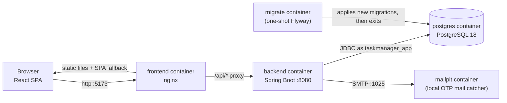
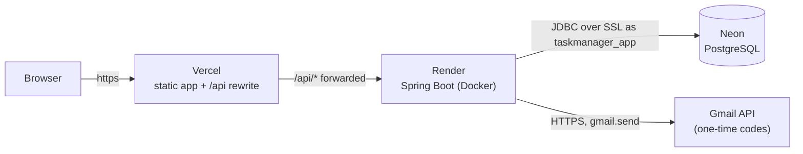
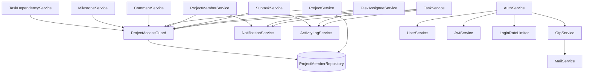

# System Architecture

How the application is put together. File and class names are the real ones; the reasoning behind the main choices is recorded as decision records in [adr/](adr/README.md).

## 1. Runtime topology



**Hosted topology** (the deployment at `https://www.task-flow.lat`, see [../host/README.md](../host/README.md)): the static app and the `/api/*` rewrite are served by Vercel, the backend runs on Render from the same Dockerfile, the database is Neon, and one-time codes are e-mailed through the Gmail API because Render's free tier blocks SMTP.



Defined in `docker-compose.yml`:

| Service | Image / build | Host port | Notes |
|---|---|---|---|
| `postgres` | `postgres:18-alpine` | `${POSTGRES_PORT:-5432}` | Runs everything in `database/init/` on first start of an empty volume (`pgdata`) |
| `migrate` | `flyway/flyway:11` | none | One-shot: applies `database/taskmanager/migrations` to the database (baseline 8) and exits; the backend waits for it to succeed. Uses the `postgres` superuser because migrations change the schema |
| `mailpit` | `axllent/mailpit:latest` | `1025` (SMTP), `8025` (web UI) | |
| `backend` | `./backend` (multi-stage: Maven build, Temurin 25 JRE, runs as non-root user `spring`) | `${BACKEND_PORT:-8080}` | Waits for `postgres` and `mailpit` to be healthy and for `migrate` to complete; log file mounted at `./backend/logs` |
| `frontend` | `./frontend` (multi-stage: `npm run build`, then nginx) | `${FRONTEND_PORT:-5173}` → container port 80 | Waits for `backend` to be healthy |

The backend and frontend containers hold a **built copy** of the code. Changing source does not change a running container until the image is rebuilt (see [setup.md](setup.md)).

In local development (`npm run dev`), Vite's dev server replaces nginx and proxies `/api` to `http://localhost:8080` (`frontend/vite.config.js`). The frontend code is identical in both cases because it only uses relative `/api/...` URLs.

## 2. Backend architecture

### 2.1 Layers

```
HTTP request
   │
   ▼
Spring Security filter chain ── validates the JWT (signature + expiry); no JSON body on failure (401)
   │
   ▼
controller/        binds the request, runs Bean Validation (@Valid), reads the caller's name
   │                from Authentication, delegates — contains no business rules
   ▼
service/           business rules, authorization (ProjectAccessGuard), transactions,
   │                entity ↔ DTO mapping, notification and activity-log writes
   ▼
repository/        Spring Data JPA interfaces (derived queries and a few @Query methods)
   │
   ▼
PostgreSQL         constraints and triggers enforce the rules that must never be bypassed
```

Errors from any layer are turned into JSON by `exception/GlobalExceptionHandler` (`@RestControllerAdvice`). See [security.md](security.md#6-error-handling).

### 2.2 Services and what they own

| Service | Responsibility |
|---|---|
| `AuthService` | Login (with `LoginRateLimiter`), registration, OTP verify/resend |
| `JwtService` | Issues HS512 access tokens (`sub` = username, optional `role` claim, 15 min default expiry) |
| `RefreshTokenService` | The long-lived half of the session: random refresh tokens stored as SHA-256 hashes (`refresh_tokens`), validated, revoked on sign-out and on a password change |
| `OtpService`, `MailService` | One-time codes (bcrypt-hashed) for registration and for the administrator's sign-in (purposes `REGISTRATION`, `LOGIN_2FA`), expiry, attempt cap, resend cooldown; `MailService` sends over SMTP or, when the `GMAIL_*` values are set, through the Gmail API |
| `CustomUserDetailsService` | Adapts a `User` for Spring Security; only `ACTIVE` accounts are enabled |
| `UserService` | User CRUD, self-service profile/password/photo/preferences, position/department, registration |
| `RoleService`, `RolePermissionService`, `PositionService`, `DepartmentService` | Role list, the role × resource × action matrix and its guarded editing, and the two org-wide lookup lists |
| `ProjectService` | Project CRUD, project-code generation, manager handling |
| `ProjectMemberService` | Membership, invitations (invite / accept / decline), pending count, invitable-user search |
| `ProjectAccessGuard`, `PermissionService`, `ProjectOwnership` | **The single authorization entry point**: `ProjectAccessGuard.assertCan / assertSystemCan / assertAccess` answer through `PermissionService`, an in-memory snapshot of the `role_permissions` table ([ADR-0014](adr/0014-requirement-roles-and-permission-matrix.md)); `ProjectOwnership` is the one place that moves a project's single `OWNER` ([ADR-0015](adr/0015-two-level-roles-system-and-project.md)) |
| `MilestoneService` | Milestone CRUD |
| `TaskService` | Task CRUD, visibility scoping, status/priority/due-date change logging, "blocked", subtask and `actualHours` figures on responses |
| `TaskApprovalService` | The approval workflow: submit for review, decide (approve / request changes / reject), the named approver, the approver's inbox |
| `TaskAssigneeService`, `TaskDependencyService` | Assignment and dependencies |
| `SubtaskService`, `ChecklistItemService` | Subtasks (and the To Do → In Progress auto-promotion) and checklist items |
| `CommentService` | Comments |
| `AttachmentService` | File attachments on tasks and projects (bytes in `attachment_contents`, types checked by `util/FileTypeGuard`) |
| `WorkLogService` | Time tracking: work logs behind a task's `actualHours` |
| `NotificationService` | Creates notifications and serves the caller's own |
| `DeadlineNotificationService` | Deadline reminders and overdue notices; started by `config/DeadlineScheduler` (daily at 08:00 and at startup) |
| `ActivityLogService` | Writes and reads the task, project and recent activity feeds |
| `DashboardService`, `TeamViewsService` | Dashboard statistics; the team-tasks and workload views (`util/Derived`, `util/WorkloadClassifier`) |
| `ReportService` | The five KPIs and the seven named reports, scoped by `REPORT:GENERATE_REPORTS` |

### 2.3 Major module relationships



`ProjectAccessGuard` depends on `ProjectMemberRepository` and `PermissionService`; every project-scoped service depends on it. `NotificationService` and `ActivityLogService` are called *by* other services right after the triggering change is saved — they never call back.

### 2.4 Cross-cutting design

- **DTOs everywhere.** No controller binds or returns a JPA entity. Nested objects (for example `ProjectResponse.manager`) are `UserResponse` DTOs.
- **Schema owned by SQL, not Hibernate.** `ddl-auto=validate`: the application refuses to start if an entity does not match the real schema.
- **Business rules at two levels.** Per-request rules (permissions, friendly error messages) live in services; cross-row invariants (dependency order, due dates, owner integrity, progress) live in database triggers so no code path can bypass them. Several rules exist at both levels on purpose (for example completing a task with open subtasks) — the service gives a clean early error, the trigger is the backstop.
- **Stateless.** No HTTP session; CSRF protection is disabled (`SecurityConfig`) because requests authenticate with a bearer token.
- **Single-instance assumptions.** `LoginRateLimiter` keeps its state in memory.

## 3. Frontend architecture

### 3.1 Composition

`src/main.jsx` wraps the app in providers, outermost first:

```
BrowserRouter
└─ AuthProvider            JWT, current user, login/logout, profile refresh
   └─ ThemeProvider        light / dark / system, synced to the saved preference
      └─ UsersProvider     user directory (GET /api/users) for avatars and name lookups
         └─ NotificationsProvider   notification list, unread count, read / delete
            └─ ToastProvider        transient success / error / warning / info messages
               └─ App     routes
```

`App.jsx` defines the routes. Everything except `/login`, `/register`, `/verify-otp`, `/privacy-policy` and `/terms-of-service` sits behind `auth/ProtectedRoute`, which redirects to `/login` (remembering the original location); at `/` it shows the public home page (`Landing`) to a signed-out visitor instead. Authenticated pages render inside `layout/AppLayout` (sidebar + page). `/reports`, `/admin/users` and `/admin/roles` are additionally wrapped in `auth/RequirePermission`, which shows the 403 error page when the matrix does not grant the action. `layout/AppLayout` also mounts `auth/IdleLogout`, the inactivity warning and automatic sign-out.

### 3.2 Data access

- `api/client.js` — `apiFetch(path, { method, body, skipAuth })` adds `Authorization: Bearer <token>` (the access token is kept in memory only; `localStorage` key `taskflow.auth` holds just the username and role), sends JSON, and throws an `ApiError(status, message, fieldErrors)`. A `401` on an authenticated call first asks `POST /api/auth/refresh` (the httpOnly cookie is the credential) for a new token, once, and repeats the request; only a failed refresh clears the stored auth and triggers logout. `apiUpload` does the same for multipart uploads and `apiDownload` fetches a file with the token (attachments).
- `api/<resource>.js` — one small module per backend resource (`projects.js`, `tasks.js`, `projectMembers.js`, …). They are thin wrappers over `apiFetch`.
- `api/useApi.js` — a minimal fetch-on-mount hook returning `{ data, loading, error, refetch }`. It refetches when the `fetcher` function identity changes, so callers wrap fetchers in `useCallback`. There is no React Query/SWR; mutations call `refetch()` afterwards.
- Derived data helpers: `api/stats.js` (dashboard and report figures), `api/relations.js` (id → users maps, the caller's role per project), `api/format.js`, `api/validation.js` (password rules, mirrored from the backend), `api/permissions.js`.

### 3.3 Permissions in the UI

The UI no longer carries its own copy of the rules. After login `AuthContext` loads `GET /api/users/me/permissions` (a list of `RESOURCE:ACTION` strings, per project and system-wide) and exposes `can(resource, action, projectId)`, `canSys(...)` and `canAny(...)`; `api/permissions.js` only turns that list into those helpers. Controls the caller cannot use are hidden, not disabled. It is a convenience only — the backend remains the authority, and editing the matrix changes both at once.

### 3.4 Frontend pages and routes

| Route | Page | Purpose |
|---|---|---|
| `/login`, `/register`, `/verify-otp` | `Login`, `Register`, `VerifyOtp` | Public. Registration shows a live password checklist; OTP page has a 60 s resend cooldown; for an administrator, when `ADMIN_2FA_ENABLED` is on, `Login` shows a second form for the e-mailed sign-in code |
| `/` (signed out), `/privacy-policy`, `/terms-of-service` | `Landing`, `PrivacyPolicy`, `TermsOfService` | Public, in the light `PublicLayout` frame (skip link, header, theme toggle, footer with the legal links); `/` shows `Landing` only while nobody is signed in |
| `/` | `Dashboard` | Project and task statistics (from `GET /api/dashboard/stats`), the activity chart (`GET /api/dashboard/task-activity`), due and overdue tasks, project cards, *Delayed projects*, recent activity and, for people who can assign tasks, team workload |
| `/tasks` | `Tasks` | Tasks grouped by project then status; search, filter (status, priority, assignee, due date, project, *My Tasks*), sort, quick views (Today, Upcoming, In Progress, Completed, Overdue); create/edit/delete; expandable subtasks; *Awaiting your approval* at the top |
| `/projects`, `/projects/:id` | `Projects`, `ProjectDetail` | Project cards; detail with status/priority, completion date, tasks, members (role picker, ownership transfer), milestones (add, edit, delete), attachments, activity |
| `/projects/:id/:view` | `ProjectViews` | `team`, `workload`, `timeline` or `gantt` for one project |
| `/kanban` | `Kanban` | Columns To Do, In Progress, In Review, Blocked (To Do tasks waiting on an unfinished prerequisite) and Completed, each read from the server on its own, 25 cards at a time with its total |
| `/calendar` | `Calendar` | Month / Week / Day views of task due dates and milestones |
| `/team` | `Team` | Directory, per-member projects, invite to a project, remove from a project, position/department |
| `/reports` | `Reports` | Needs `REPORT:GENERATE_REPORTS`. Tabs: Overview charts, KPIs and the seven named reports (data from `GET /api/reports/*`) |
| `/admin/users`, `/admin/roles` | `UsersAdmin`, `RolesPermissions` | Administration: system role per account, edit / status / delete (`USER:VIEW`; the buttons need `USER:EDIT` / `USER:DELETE`), and the role × resource × action grid (`ROLE:VIEW`) |
| `/admin/audit` | `AuditLog` | Administration → Audit log: the append-only administrator log (Administrator role only; `GET /api/audit-logs`) |
| `/profile`, `/settings` | `Profile`, `Settings` | Personal info, password, photo; theme and notification preference |
| `/help` | `Help` | Help & Support (static FAQ) |
| `/error/:status`, any unknown path | `ErrorPage` | One page for every error status (404 for unknown paths, 403 from the permission guard) |

The task detail panel (`components/TaskDetailPanel.jsx`) is a right-hand drawer with subtasks, comments, dependencies and the activity feed. New Task, Edit Task, New Project, Edit Project, Add member (project page) and Add User (Team page) all open in the shared `SidePanel` (`TaskFormModal`, `NewProjectModal`, `AddProjectMemberModal`, `AddMemberModal`).

## 4. API communication

- All calls go to relative `/api/...` paths; there is no configurable API base URL.
- JSON in, JSON out; success codes `200`, `201` (every `POST` that creates), `204` (every `DELETE` and `POST /api/notifications/read-all`). Endpoints that return nothing but are not deletes (`verify-otp`, `resend-otp`, `PUT /api/users/me/password`) answer `200` with an empty body.
- Errors use one shape (`timestamp`, `status`, `error`, `message`, `fieldErrors`) — see [api-reference.md](api-reference.md#2-conventions).
- Updates are **full-replace** `PUT`s (no `PATCH`): the client resends the whole object (`taskResponseToRequest` in `api/tasks.js` builds it).
- List endpoints return everything the caller may see. Paging is optional (`?page` / `?size`) on the project, task and notification lists only, and the notification bell uses it; the invitable-user search is capped at 20.
- Data is fetched on page load and after the user's own actions. There is **no polling or push**: for example, a newly received notification appears after the next reload/refetch.

## 5. Database access

JPA entities map the schema; repositories are Spring Data interfaces. Visibility scoping is done in services by first loading the caller's active project ids (`ProjectMemberRepository.findProjectIdsByUserId`) and filtering. The only database-level paging/filtering query is `UserRepository.findInvitableUsers`. Details: [database.md](database.md).

## 6. Important architectural decisions (summary)

Each has a full record with context, alternatives and consequences in [adr/](adr/README.md).

| Decision | Record |
|---|---|
| Stateless JWT instead of server sessions | [ADR-0001](adr/0001-stateless-jwt-authentication.md) |
| Authorization from per-project roles, not global roles | [ADR-0002](adr/0002-project-level-authorization.md) (partly superseded) |
| A data-driven permission matrix | [ADR-0014](adr/0014-requirement-roles-and-permission-matrix.md) |
| Two-level roles: system roles and project roles | [ADR-0015](adr/0015-two-level-roles-system-and-project.md) |
| An e-mailed second sign-in step for administrators; codes over HTTPS when SMTP is blocked | [ADR-0016](adr/0016-admin-two-factor-and-https-mail.md) |
| Optional "Sign in with Google" that signs in only accounts connected beforehand, keyed by Google's `sub` | [ADR-0017](adr/0017-link-only-google-sign-in.md) |
| "Sign in with Google" may also create an account (a username the person chooses); such an account sets its first password with Google | [ADR-0018](adr/0018-google-sign-up-and-first-password.md) |
| A project *is* the team; invitations live on `project_members` | [ADR-0003](adr/0003-project-membership-and-invitations.md) |
| Task assignment as a join table with database-enforced rules | [ADR-0004](adr/0004-task-assignment-model.md) |
| Hand-written SQL schema; invariants in triggers | [ADR-0005](adr/0005-database-owned-schema-and-triggers.md) |
| DTOs on every endpoint | [ADR-0006](adr/0006-dto-layer.md) |
| Notifications written by application code | [ADR-0007](adr/0007-application-created-notifications.md) |
| Self-registration with emailed OTP | [ADR-0008](adr/0008-self-registration-with-otp.md) |
| Profile photos stored in the database, served by token | [ADR-0009](adr/0009-profile-photos-in-database.md) |
| Frontend calls relative `/api` paths behind a proxy | [ADR-0010](adr/0010-relative-api-paths-and-proxy.md) |
| Least-privilege database role for the backend | [ADR-0011](adr/0011-least-privilege-database-role.md) |
| Progress is derived by the database | [ADR-0012](adr/0012-derived-progress.md) |
| Task status is manual, with guarded exceptions | [ADR-0013](adr/0013-manual-task-status-with-guards.md) |
